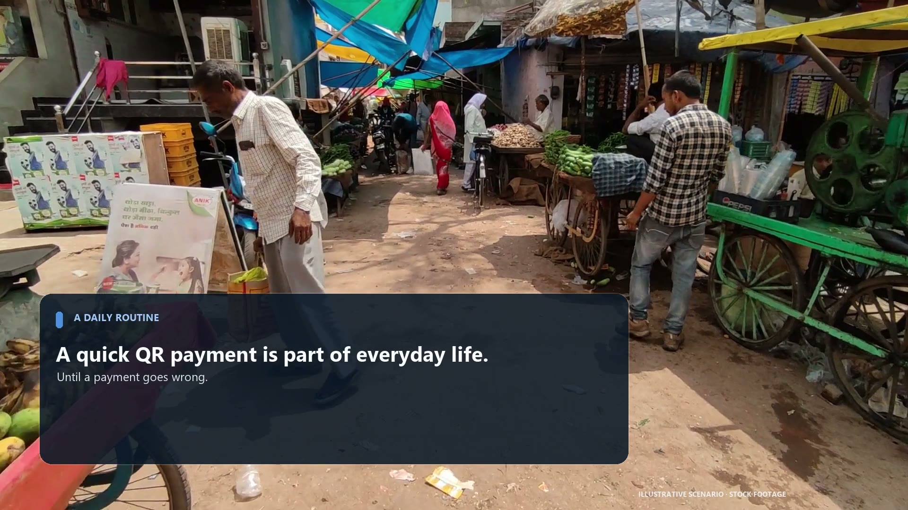
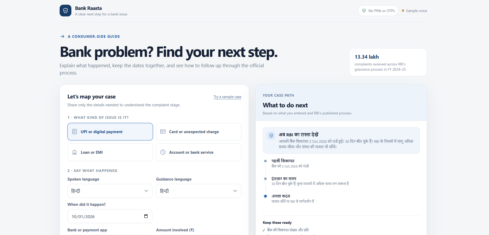
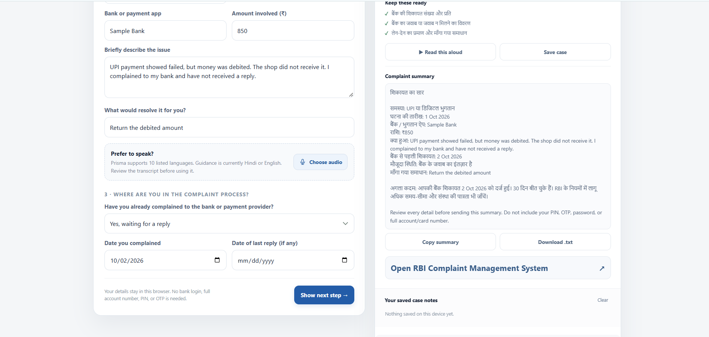
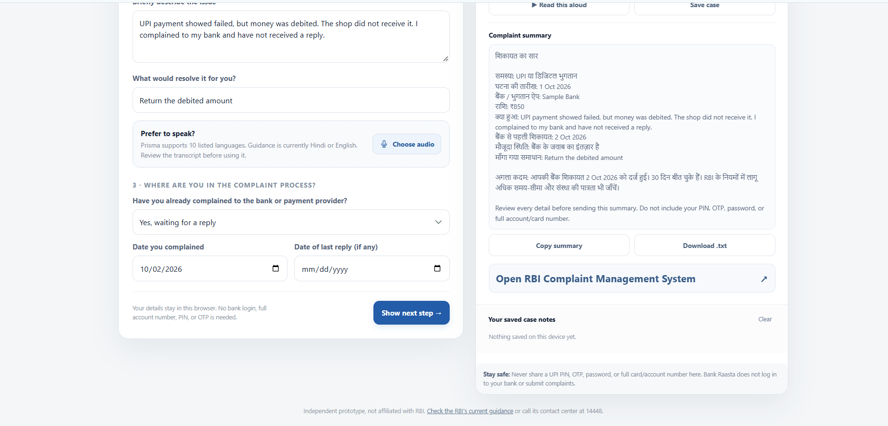

# Bank Raasta

**A voice-first guide for the moment a payment goes wrong.** Write what happened in your words, keep the complaint dates together, and see the official next step — including RBI's escalation route.

| Live demo | Demo film (2:13) |
| --- | --- |
| **[Open Bank Raasta →](https://yakshini12.github.io/bank-raasta/)** — runs instantly, sample voice, nothing to install | [](submission/Bank-Raasta-demo.mp4) |

> Live demo URL activates after GitHub Pages is enabled once (Settings → Pages → Deploy from branch → `main` / `docs`). No account, no data leaves the browser.

The UPI fails, the money is debited, and the shop never sees it. Nobody is sure whose problem it is. In FY 2024–25 the Reserve Bank received **13,34,244 complaints** under its Integrated Ombudsman Scheme — and the rule that trips people up is simple: approach your bank first, and escalate to the RBI Ombudsman only after a poor or missing reply. Bank Raasta walks a person through that path in one screen.

## What it does

| | |
| --- | --- |
|  |  |
| **Start with what happened** — what went wrong, which bank or app, how much, what you wanted | **Details** — the facts, with Gnani Prisma speech input; the transcript stays editable |
|  | |
| **Next step & summary** — a dated next step from the complaint facts, plus a copyable case summary in Hindi or English | |

- Voice input for the story (Gnani Prisma, ten Indian languages) — the transcript is shown for review, never auto-submitted
- Guidance and case summaries in Hindi or English; read-aloud is wired for Gnani Timbre
- Deterministic next-step from the complaint date, reply status, and issue category
- Keeps the complaint number, bank reply, and transaction proof in one checklist
- A privacy floor: no bank login, no PIN/OTP, notes stay in the browser, and the app never files the complaint for you

## How it runs

Bank Raasta is a single self-contained page (`docs/index.html`) plus a tiny Node server. The Node process is only there to keep the Gnani API key private (`server.js` proxies `/api/stt` and `/api/tts`). Without a key it runs in **sample mode**: no server calls, browser speech synthesis for read-aloud — which is exactly what the live demo and the demo film show. Nothing is uploaded anywhere; saved notes live in `localStorage`.

## Run locally

Requires Node.js 20 or later.

```powershell
Copy-Item .env.example .env   # optional; add GNANI_API_KEY to enable real voice
npm start
```

Open <http://127.0.0.1:3003>. Without an API key everything works in sample mode; add `GNANI_API_KEY` to `.env` to turn on Prisma transcription and Timbre read-aloud. Do not commit `.env`.

## Gnani integration

- Prisma transcription: `POST https://api.vachana.ai/stt/v3`
- Timbre synthesis: `POST https://api.vachana.ai/api/v1/tts/inference`
- The browser talks only to the local server; the key never reaches the client.
- The transcript is surfaced for review and never fills dates or decides outcomes by itself.

## Repo map

```
server.js              Node server: static pages + Gnani proxy (key stays private)
docs/index.html        The whole app — one self-contained page (GitHub Pages deploys this)
submission/
  Bank-Raasta-demo.mp4     Final narrated demo film (2:13), playable above
  ...-final.mp4            Same cut before narration
  solution-pitch.md        One-page pitch
  demo-video-script.md     Scene script, real vs illustrative, stock credits
  dialogue-script.md       Narration text and beat placement
  render_final_cut.py      Regenerates the visual cut
  create_dialogue_track.py Adds the English-India narration
  assets/                  App screenshots + stock photos used by the film
```

The demo film is fully regenerable — see [`submission/README.md`](submission/README.md). Stock media is Pexels (credited in [`submission/demo-video-script.md`](submission/demo-video-script.md)).

## Prototype boundary

This is a consumer-side guide, not a channel for filing complaints. No account access, payment credentials, OTP/PIN collection, complaint submission, or outcome guarantees. General process guidance — confirm current rules with RBI or your bank.

## Sources

- [RBI Annual Report on the Integrated Ombudsman Scheme, FY 2024–25](https://www.rbi.org.in/scripts/PublicationsView.aspx?id=23441) — the 13,34,244 figure
- [RBI Integrated Ombudsman Scheme FAQ](https://www.rbi.org.in/commonperson/english/scripts/FAQs.aspx?Id=3407) — bank-first, then Ombudsman
- [Gnani Prisma docs](https://docs.gnani.ai/api/STT/speech-to-text) · [Gnani Timbre docs](https://docs.gnani.ai/api/TTS/tts-inference)
